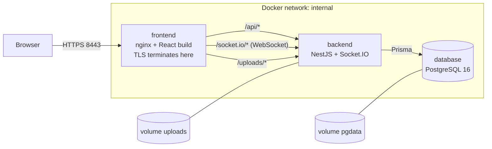
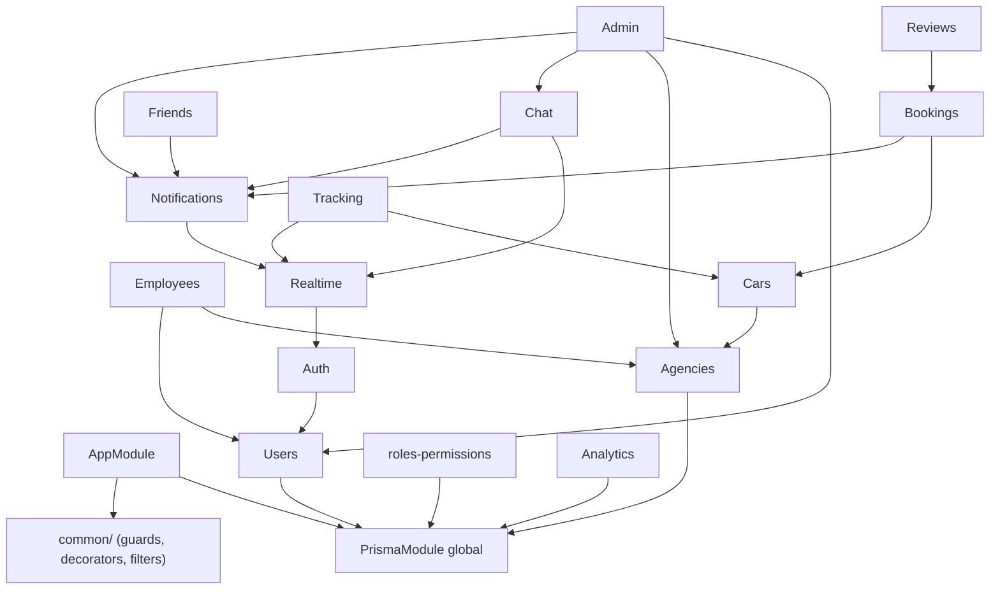
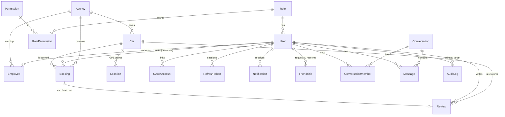
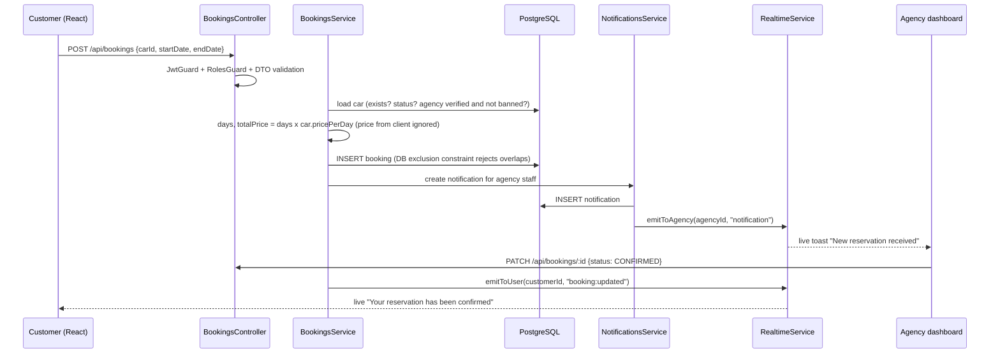
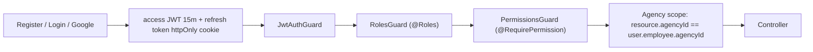
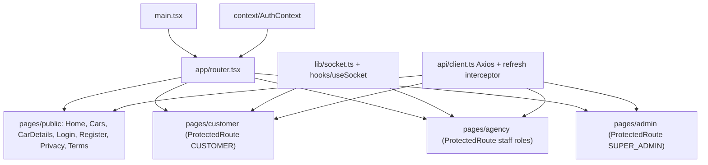

# FleetFlow: System Design Map

Diagrams use Mermaid (GitHub renders them automatically).

## 1. Containers (3)

Rules: only `frontend` publishes ports. The browser never reaches `backend` or `database` directly. The React code only talks to `/api` and `/socket.io` on its own origin, so there are no CORS problems and all traffic is HTTPS.

## 2. Backend modules and who depends on whom

Reading it: an arrow means "imports / calls". `Realtime` is the only place that owns the Socket.IO server. Every other module pushes events through `RealtimeService.emitToUser()` or `emitToAgency()`. That keeps one authentication handshake and one set of rooms.

Every module has the same files: `*.module.ts`, `*.controller.ts` (URLs), `*.service.ts` (logic + Prisma), `dto/*.ts` (validation).

## 3. Database (ER diagram)

| Relationship | Why it exists |
|---|---|
| User → Role (N:1) | One role per account; permissions come from the role |
| Role ↔ Permission (N:M via RolePermission) | Permission matrix is data, not hard-coded `if`s |
| User → Employee → Agency | Staff accounts belong to exactly one agency; guards use this to isolate agencies |
| Agency → Car (1:N) | Fleet ownership; every car query by staff is filtered by `agencyId` |
| Booking → Car, User, Agency | `agencyId` is copied from the car so analytics and dashboards need no join through Car |
| Booking.pricePerDay / totalPrice | Snapshot so later price edits never change old bookings |
| Booking → Review (1:0..1) | Only a COMPLETED booking can be reviewed, once |
| Car → Location (1:N) | GPS history; latest row = current position |
| Conversation ↔ User (N:M via ConversationMember) | Replaces `receiver_id`: supports 1:1, customer↔agency, admin Support, `lastReadAt` for unread counts |
| Friendship (requester, addressee) | Unique pair, status PENDING/ACCEPTED/BLOCKED |
| AuditLog → User (admin, target) | Every verify/ban/unban/support message |

Postgres enforces what Prisma cannot: see `backend/prisma/sql/booking_no_overlap.sql` (no two active bookings on one car with overlapping dates).

## 4. Booking flow

## 5. Real-time design (Socket.IO)

- One gateway in `realtime/`. On connect the client sends its access token; the server verifies the JWT and refuses banned users.
- Rooms: `user:{userId}` (private events), `agency:{agencyId}` (staff of one agency), `car:{carId}` (live tracking page).
- Events:

| Event | Direction | Room | Used by |
|---|---|---|---|
| `notification` | server → client | `user:*` | bell, toasts |
| `booking:updated` | server → client | `user:*`, `agency:*` | My bookings, Reservations |
| `car:status` | server → client | `agency:*` | Fleet page |
| `chat:send` / `chat:message` | both | `user:*` | Chat |
| `chat:read` | client → server | | unread counts |
| `presence` | server → client | friends' `user:*` | online dot |
| `tracking:update` | server → client | `agency:*` | Leaflet map |
| `admin:kick` | server → client | `user:*` | ban ends session and disconnects socket |

- Presence: socket count per user in memory; `lastSeenAt` saved on last disconnect.
- Reconnect: client re-sends token and rejoins rooms, then refetches missed data over REST (`/notifications`, `/chat/:id/messages?after=`).
- GPS simulator: a Nest provider in `tracking/` (enabled by `SIMULATOR_ENABLED`) that moves each RENTED car along a route near its city every `SIMULATOR_INTERVAL_MS`, saves a `Location` row and emits `tracking:update`.

## 6. Authentication and authorization

| Role | Scope | Can |
|---|---|---|
| CUSTOMER | own data | browse, book, cancel own, profile, friends, chat, review |
| AGENCY_EMPLOYEE | own agency | read fleet, bookings, customers; update booking status |
| AGENCY_MANAGER | own agency | + manage cars, analytics, manage employees (employee level) |
| AGENCY_ADMIN | own agency | + employees/roles, agency settings |
| SUPER_ADMIN | platform | verify/reject agencies, ban/unban, support chat, audit log, all users |

Guard order matters: authentication, role, permission, then agency ownership (the step people forget; without it manager of agency A can edit agency B's cars).

## 7. Frontend structure

